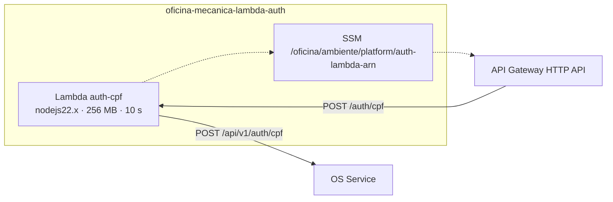
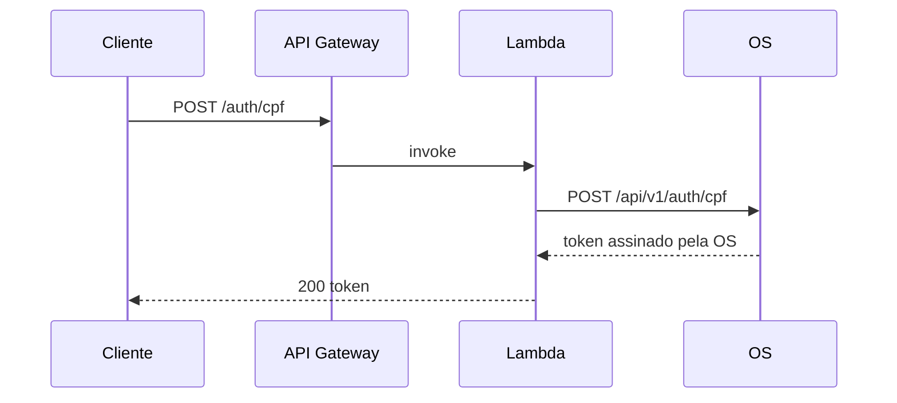

# Autenticação do cliente via CPF (Lambda)

Função serverless: valida o CPF, chama `POST /api/v1/auth/cpf` na OS e devolve o JWT que a OS assinou. O login de administrador continua na OS.

A OS dona do cliente e do token é [oficina-mecanica-os-service](https://github.com/32SOAT/oficina-mecanica-os-service). A decisão da borda está na [ADR 003](https://github.com/32SOAT/oficina-mecanica-os-service/blob/main/docs/adr/003-borda-publica-do-gateway.md).

O API Gateway HTTP pertence ao repositório `oficina-mecanica-infra-k8s`. O contrato entre os dois repositórios está em [docs/integration/infra-k8s.md](docs/integration/infra-k8s.md).

## Tecnologias

Node 22 · TypeScript · API Gateway HTTP API · Terraform · GitHub Actions

## Arquitetura deste repositório



A função não assina JWT e não usa o token da saga. A única variável de ambiente obrigatória é `OS_BASE_URL`.

## Fluxo



| Rota no Gateway | Destino |
| --- | --- |
| `POST /auth/cpf` | Lambda, que chama a OS e devolve o JWT da OS |
| `GET /api/v1/pagamentos/{osId}/checkout` e `POST .../cobrar` | Billing |
| `ANY /{proxy+}` | OS |

## Contrato HTTP

`POST /auth/cpf`

```json
{ "cpf": "529.982.247-25" }
```

- `200` `{ "token": "..." }` com o token assinado pela OS
- `400` CPF ausente ou inválido
- `401` cliente não encontrado ou inativo
- `503` OS indisponível ou resposta sem token

## Como rodar localmente

A OS precisa estar no ar em `http://localhost:3001`. O container chama esse endereço pelo host e expõe `POST /auth/cpf` na porta 3000.

```bash
npm run docker:up
```

```powershell
Invoke-RestMethod -Method POST -Uri http://localhost:3000/auth/cpf `
  -ContentType "application/json" `
  -Body '{"cpf":"529.982.247-25"}'
```

Para parar: `npm run docker:down`. Logs: `npm run docker:logs`.

Sem Docker:

1. Suba a OS em `http://localhost:3001`.
2. Copie `.env.example` para `.env`.
3. Rode `npm run dev:local`.
4. Chame `http://localhost:3000/auth/cpf`.

O CPF precisa existir como cliente ativo na OS. O seed usa `529.982.247-25`.

## Testes

```bash
npm ci
npm test
npm run build
npm run test:integration
```

O bundle fica em `dist/handler.js`, handler `handler.handler`.

## Deploy

A OS precisa estar no ar antes desta função. O API Gateway é aplicado depois, pelo `oficina-mecanica-infra-k8s`.

1. `npm run build`
2. `cd infra` e copie `terraform.tfvars.example` para `terraform.tfvars`
3. Preencha `os_base_url` com a URL do NLB da OS, sem barra no final
4. Em conta com restrição de IAM, informe `lambda_role_arn`
5. `terraform init` e `terraform apply`

O apply publica `/oficina/<ambiente>/platform/auth-lambda-arn`. O gateway também lê `/oficina/<ambiente>/services/os-nlb-hostname` e `/oficina/<ambiente>/services/billing-checkout-nlb-hostname`, publicados pelos deploys da OS e do billing.

O procedimento completo está em [docs/integration/infra-k8s.md](docs/integration/infra-k8s.md).
