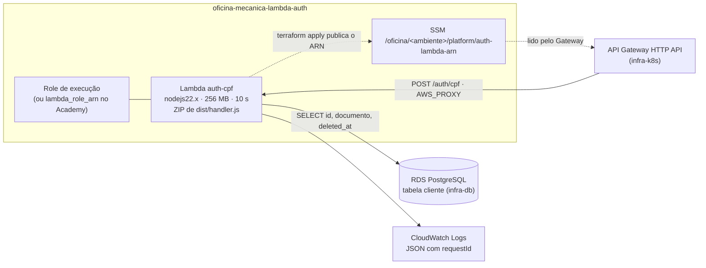

# Autenticação do cliente via CPF (Lambda)

Function serverless: valida CPF, consulta o cliente na OS por HTTP e devolve um JWT. **Login de admin (e-mail/senha) continua na OS.**

API Nest (roles, rotas, JWT): [oficina-mecanica-api](https://github.com/32SOAT/oficina-mecanica-api) — em especial [docs/architecture/auth.md](https://github.com/32SOAT/oficina-mecanica-api/blob/main/docs/architecture/auth.md).

O API Gateway HTTP e o proxy para o Nest pertencem exclusivamente ao repositório `oficina-mecanica-infra-k8s`.

O guia de handoff entre os dois repositórios está em
[docs/integration/infra-k8s.md](docs/integration/infra-k8s.md). Ele documenta a
ordem de provisionamento, os parâmetros SSM, a configuração por ambiente e a
validação do endpoint público.

## Tecnologias

Node 22 · TypeScript · `jsonwebtoken` · API Gateway HTTP API · Terraform · GitHub Actions

## Arquitetura deste repositório



Terraform em `infra/`: function, role (ou `lambda_role_arn` no Academy), `vpc_config` opcional e o parâmetro SSM. O API Gateway é do `infra-k8s`. Documentação arquitetural completa (componentes, sequência de autenticação, RFC 003, ADR 003): [oficina-mecanica-api/docs](https://github.com/32SOAT/oficina-mecanica-api/blob/main/docs/README.md).

## Fluxo

```mermaid
sequenceDiagram
  participant C as Cliente
  participant GW as API Gateway
  participant L as Lambda
  participant OS as OS

  C->>GW: POST /auth/cpf { "cpf": "529.982.247-25" }
<<<<<<< Updated upstream
  GW->>L: invoke (AWS_PROXY)
  L->>DB: SELECT cliente WHERE documento = cpf
  L-->>C: 200 { "token": "JWT" }
=======
  GW->>L: proxy
  L->>OS: POST /api/v1/clientes/consulta-auth
  L-->>C: 200 { "token": "<jwt>" }
>>>>>>> Stashed changes

  C->>GW: GET /api/v1/ordens/{id}/status Authorization Bearer
  GW->>OS: HTTP proxy
  OS-->>C: status da OS
```

JWT (`role: cliente`):

```json
{ "sub": "<id-do-cliente>", "cpf": "52998224725", "role": "cliente" }
```

Use o **mesmo `JWT_SECRET`** da OS e o **mesmo `SAGA_TOKEN`** na consulta do cliente. Cliente excluído (`deletedAt` preenchido) não autentica. A OS recusa JWT de cliente nas rotas de oficina (`RolesGuard`; default = admin) e aceita nas de status, aprovar e reprovar.


| Rota no Gateway                              | Destino                                |
| -------------------------------------------- | -------------------------------------- |
| `POST /auth/cpf`                             | Lambda                                 |
| `ANY /{proxy+}` (ex.: `/api/v1/...`, `/api`) | Nest, configurado pelo `infra-k8s` |
| `POST /api/v1/auth/login`                    | Nest (admin)                           |


## Contrato HTTP

`POST /auth/cpf`

```json
{ "cpf": "529.982.247-25" }
```

- `200` `{ "token": "..." }`
- `400` CPF ausente ou inválido
- `401` cliente não encontrado ou inativo
- `503` falha de infraestrutura (OS indisponível, erro ao emitir JWT)

Essa rota não entra no Swagger do Nest. A coleção para importar no Postman está em [docs/auth-cpf.postman_collection.json](docs/auth-cpf.postman_collection.json). Troque a variável `gateway` pelo `terraform output api_endpoint`.

## Como rodar localmente

### Opção 1 — Docker (servidor HTTP)

A OS precisa estar no ar em `http://localhost:3001`, com o mesmo `SAGA_TOKEN`. O container chama essa URL pelo host e expõe `POST /auth/cpf` na porta 3000:

```bash
npm run docker:up
```

**Linux/macOS (curl):**

```bash
curl -s -X POST http://localhost:3000/auth/cpf \
  -H "content-type: application/json" \
  -d '{"cpf":"529.982.247-25"}'
```

**Windows (PowerShell):**

```powershell
Invoke-RestMethod -Method POST -Uri http://localhost:3000/auth/cpf `
  -ContentType "application/json" `
  -Body '{"cpf":"529.982.247-25"}'
```

Para parar e remover volumes:

```bash
npm run docker:down
```

Logs do serviço de auth: `npm run docker:logs`

### Opção 2 — Node no host

1. Suba a OS em `http://localhost:3001`
2. Copie `.env.example` para `.env` e use o mesmo `SAGA_TOKEN` da OS
3. Inicie o servidor local: `npm run dev:local`
4. Teste com um dos comandos da Opção 1 em `http://localhost:3000/auth/cpf`

O CPF precisa existir como cliente ativo na OS. O seed da OS usa `529.982.247-25`.

## Como rodar os testes

**Unitários** (sem a OS):

```bash
npm ci
npm test
npm run build
```

**Integração** (sobe um falso da OS na própria suíte):

```bash
npm run test:integration
```

O bundle fica em `dist/handler.js` (handler `handler.handler`).

## Deploy da Lambda (Terraform)

Ordem no Academy: **EKS + RDS + Nest no ar primeiro**, depois esta Lambda. O API Gateway é aplicado separadamente pelo `oficina-mecanica-infra-k8s`.

1. `npm run build`
2. `cd infra && cp terraform.tfvars.example terraform.tfvars`
3. Preencha `os_base_url`, `saga_token` (**igual** ao da OS) e `jwt_secret` (**igual** ao da OS).
4. **AWS Academy:** `lambda_role_arn` = ARN do `LabRole`. Sem isso o `CreateRole` falha.
<<<<<<< Updated upstream
5. Para a Lambda alcançar o RDS, informe `subnet_ids` (privadas) e `security_group_ids`.
6. Defina `environment` como `homologacao` ou `producao`.
=======
5. A consulta do cliente é HTTP. Informe `subnet_ids` e `security_group_ids` só se a OS não for alcançável pela URL pública.
6. Com o Nest no ar:

```powershell
kubectl -n oficina-mecanica get svc
```

Cole o hostname do NLB em `nest_api_url` (HTTP, **sem** barra no final):

```hcl
nest_api_url = "http://xxxx.elb.us-east-1.amazonaws.com"
```

>>>>>>> Stashed changes
7. `terraform init && terraform apply`

> O arquivo `infra/.terraform.lock.hcl` fica versionado no Git para garantir as mesmas versões dos providers em todo ambiente (local e CI). O apply publica `/oficina/<ambiente>/platform/auth-lambda-arn` para o `infra-k8s`.

Depois que a Lambda estiver publicada e o deploy Kubernetes tiver atualizado o hostname do NLB, o `infra-k8s` pode aplicar o API Gateway.

Teste:

**Linux/macOS:**

```bash
# CPF (ENDPOINT fornecido pelo output api_gateway_endpoint do infra-k8s)
curl -s -X POST "$ENDPOINT/auth/cpf" \
  -H "content-type: application/json" \
  -d '{"cpf":"529.982.247-25"}'

# Health via proxy
curl -s "$ENDPOINT/api/v1/health"

# Status da OS (cole o token do passo 1)
curl -s "$ENDPOINT/api/v1/ordens/UUID-DA-OS/status" \
  -H "Authorization: Bearer COLE_O_TOKEN"
```

**Windows (PowerShell):**

```powershell
$ENDPOINT = "https://xxxx.execute-api.us-east-1.amazonaws.com"

# CPF
Invoke-RestMethod -Method POST -Uri "$ENDPOINT/auth/cpf" `
  -ContentType "application/json" `
  -Body '{"cpf":"529.982.247-25"}'

# Health via proxy
Invoke-RestMethod -Uri "$ENDPOINT/api/v1/health"

# Status da OS (cole o token do passo 1)
Invoke-RestMethod -Uri "$ENDPOINT/api/v1/ordens/UUID-DA-OS/status" `
  -Headers @{ Authorization = "Bearer COLE_O_TOKEN" }
```

Se o health do Nest funciona no NLB direto mas **timeout** no Gateway, o NLB provavelmente está restrito por CIDR. O NLB público e o trecho HTTP entre Gateway e NLB são riscos conhecidos da arquitetura atual.

Para o procedimento completo de integração, incluindo rollback, contratos e
troubleshooting, consulte [docs/integration/infra-k8s.md](docs/integration/infra-k8s.md).
